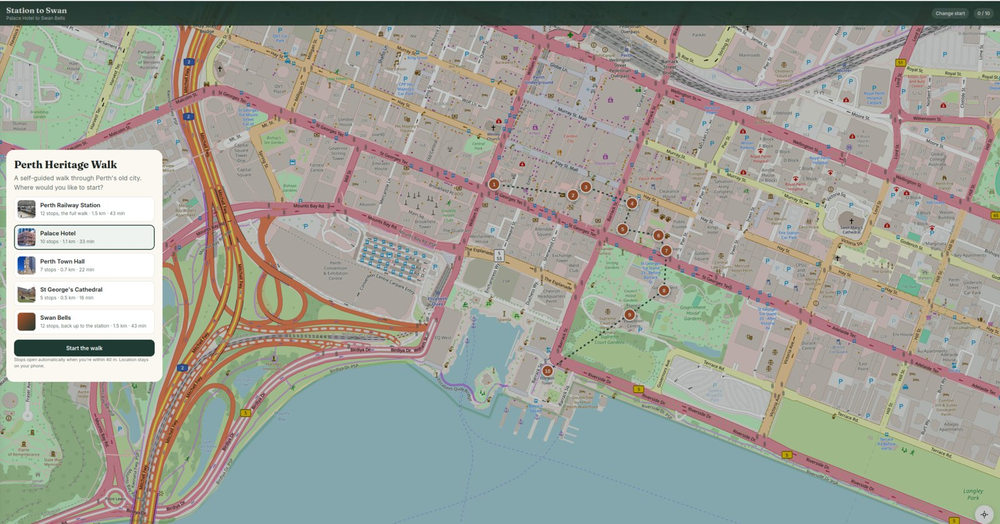
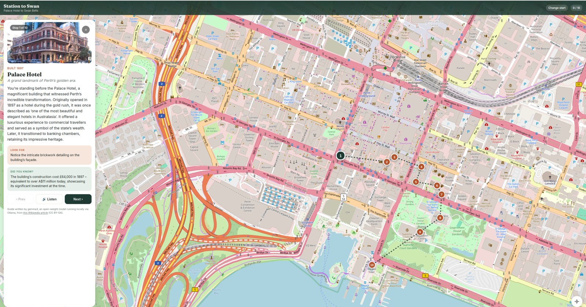

# Station to Swan: Perth Heritage Walk

A self-guided heritage walk from Perth Station down to the Swan River, written by an open-weight AI model running on a laptop.

Open the page on your phone, follow the dotted trail, and each stop's story opens when you get within 40 m.

Built for the [DEV Hacktoberfest 2026 Open-Source AI Challenge, Week 1: "Touch Grass"](https://dev.to/challenges/hacktoberfest-week1-2026-10-05).

**👉 [Try the walk](https://techgirl007.github.io/HeritageWalk/)** (best on a phone)





## How it works

```
Wikipedia ─► fetch_wiki.py ─► gemma3 via Ollama ─► stops.json ─► build_page.py ─► index.html
  facts                        writes the guide      + overrides.json            map, dots, trail
                               (runs locally)         (human fact-check)
```

1. `fetch_wiki.py` pulls each stop's article, coordinates and photo from Wikipedia into `data/wiki.json`.
2. `generate_guide.py` asks **gemma3** (running locally with [Ollama](https://ollama.com)) to turn each article into a short "you're standing in front of it" guide: story, what to look for, and a fun fact. Results are cached per stop.
3. `overrides.json` holds the corrections a human made after checking gemma's drafts against Wikipedia.
4. `build_page.py` bakes everything into one self-contained `index.html`, with a [Leaflet](https://leafletjs.com) map and [OpenStreetMap](https://www.openstreetmap.org) tiles.

## Run it yourself

```bash
ollama pull gemma3
python3 fetch_wiki.py
python3 generate_guide.py
python3 build_page.py
python3 -m http.server 8000   # then open http://localhost:8000
```

To make a walk for your own town, change `STOPS` in `fetch_wiki.py` and rerun.

## Credits

- Guide text: gemma3, fact-checked by a human. It's a small model, so treat it as a friendly guide, not a history textbook.
- Facts and photos: [Wikipedia](https://en.wikipedia.org) and Wikimedia Commons (CC BY-SA).
- Map: © OpenStreetMap contributors.

## License

Code: MIT (see `LICENSE`). Wikipedia text and photos keep their own CC BY-SA licenses.
